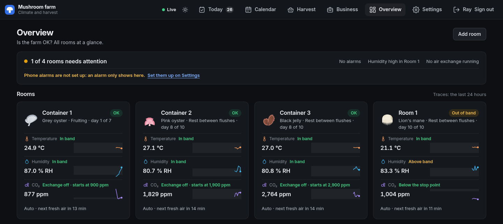
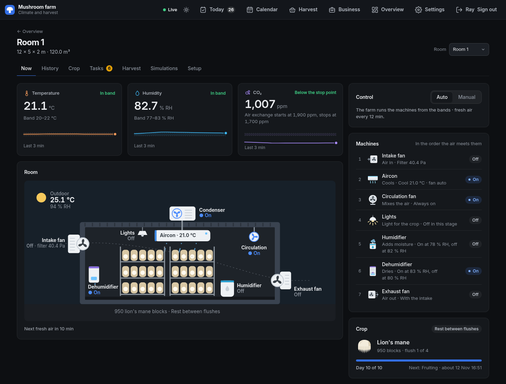
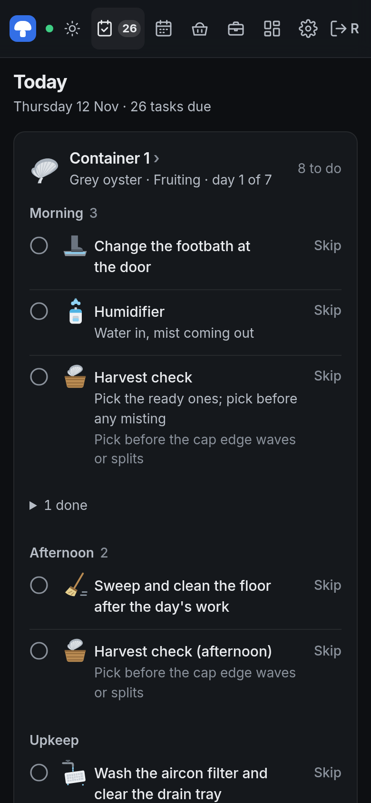
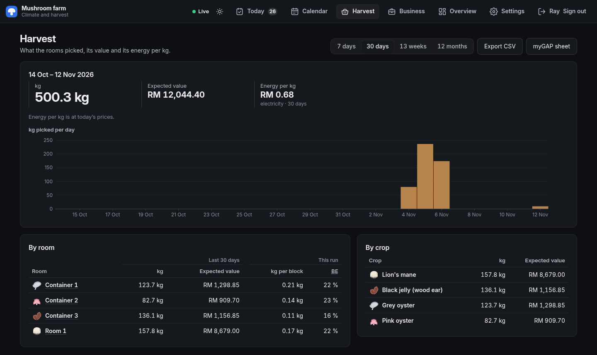
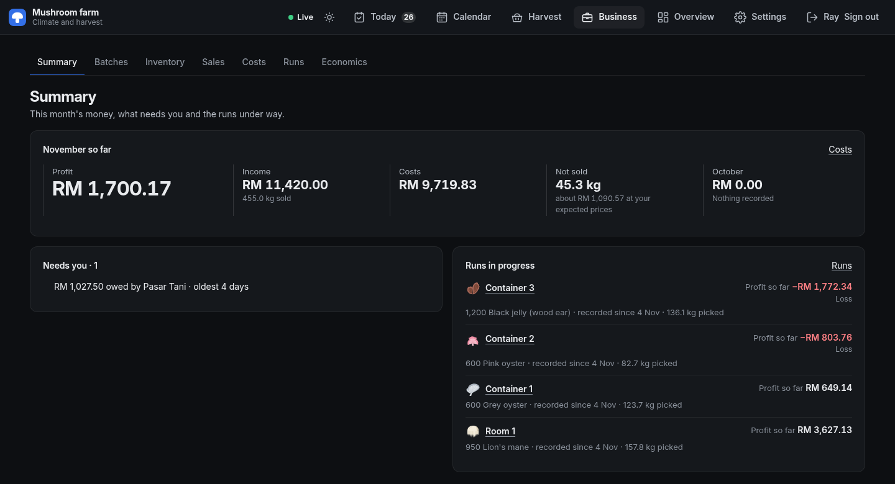
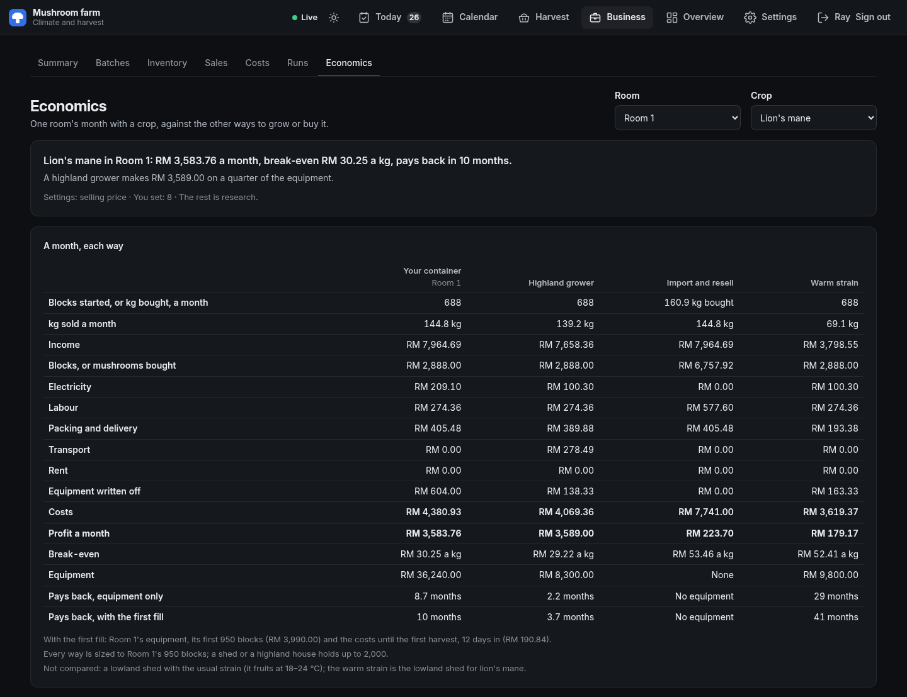
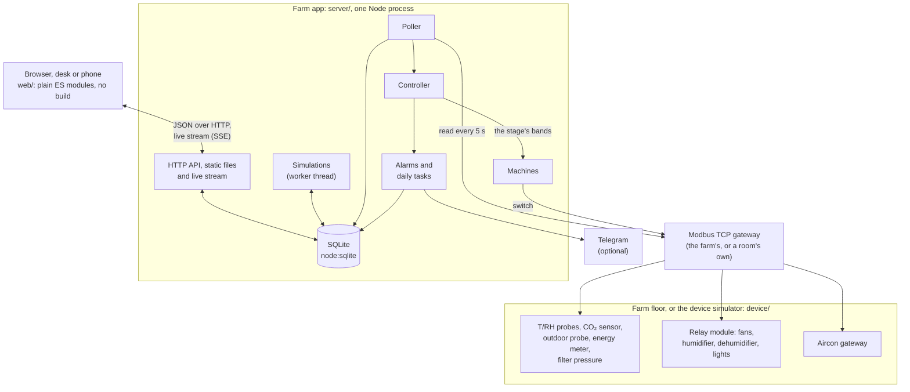

# Mushroom farm

[](https://github.com/rayy1218/mushroom-farm/actions/workflows/test.yml)  

Keeps a small mushroom farm's grow rooms in the right climate, tells the team what to do each day, and shows what every kilogram costs and earns.



Built for one farm in lowland Malaysia. The owner and the workers each sign in, on a desk or a phone.

| Jump to | For |
|---|---|
| [For farm owners](#for-farm-owners) | What it does for the farm, what it costs to run |
| [For engineers](#for-engineers) | How it is built, how to run and deploy it |

## For farm owners

### The problems it solves

| Problem | What the app does |
|---|---|
| A room runs too hot, too dry or too stuffy for a few hours, and a crop is lost | It reads every room every 5 seconds and runs the fans, humidifier, dehumidifier, aircon and lights to keep the room inside the crop's bands. Each crop stage (spawn run, pinning, fruiting, rest) has its own bands |
| Nobody notices a problem until the morning | Alarms show on every page, with a count in the menu, and reach a phone through Telegram (optional). A room out of band turns Serious after 30 min and Critical past the crop's own limits, so the phone rings for what matters. A gateway outage is one alarm, not one per machine, and cleared alarms fold away |
| Outside air is free cooling, but only some hours | An outdoor probe tells the app when outside air can cool or dry a room, so the aircon runs less |
| Workers forget a task, or do it on the wrong day | The Today page lists each room's tasks for the stage it is in, plus upkeep that is due. Workers tick them off on a phone |
| You don't know what a kilogram costs to grow | Energy (kWh and RM) and water (L) per room, harvests per room and crop, costs and sales give a profit per run and per kg |
| A month of buying looks like a loss, and stock and equipment never show | Costs counts materials when used and blocks when they go into a room; what was bought is a cash line apart, the stock is valued, equipment is written off a month at a time, and sales reach the run that grew them |
| You are about to buy a container, an aircon or a new crop and can't tell if it pays | Economics compares a month of your room with the other ways to get the crop (a highland grower, a lowland shed, importing), with the break-even price and the payback. A simulator tests a room's walls, weather and machines before you buy them |
| myGAP paperwork | Printable task, harvest and batch sheets, and CSV exports |

### What you see each day

| Screen | What it tells you |
|---|---|
| Overview | Is the farm OK? Every room's readings against its bands, alarms, the outdoor air, today's energy cost and the harvest |
| A room | Its readings, a drawing of the room with every machine on or off, the crop's stage and day, and the next fresh-air change |
| Today | The day's tasks for every room, by morning, afternoon and upkeep. Made for a phone |
| Harvest | kg picked per day, room and crop, its expected value and the energy cost per kg |
| Business | This month's profit, what needs attention, and each run's profit so far. Owner only: workers see no money |
| Economics | One room's month with one crop against the other ways to grow or buy it |

### Screens

The money and kg figures in these pictures are a made-up example month, not the farm's own. The readings come from the device simulator.

| Screen | Picture |
|---|---|
| **A room.** Readings against the bands, the room's machines as they run, and the crop's progress |  |
| **Today, on a phone.** Each room's tasks in the order of the day. Tick one when it is done, or skip it |  |
| **Harvest.** What the rooms picked, what it is worth and the electricity per kg |  |
| **Business Summary.** The month's profit, the problems that need you, and every run in progress |  |
| **Economics.** A month of lion's mane in Room 1 against a highland grower, importing, and a warm strain |  |

### What it needs

| Need | Detail |
|---|---|
| A computer | Any PC that stays on, or a small cloud VM (it runs on a free Oracle Cloud VM). No database server, no licences to buy |
| Sensors and machines | Modbus sensors and relays: temperature and humidity probes, a CO₂ sensor, an energy meter, a relay module for the fans, humidifier, dehumidifier and lights, an aircon gateway. Wired over RS-485 to an Ethernet gateway |
| No hardware yet | The built-in device simulator plays the sensors and machines, so you can try everything first |
| Phones | Any phone browser. Workers sign in with a 6-digit PIN, owners with a password |
| Phone alarms | Optional: a Telegram bot, set up on the Settings page |

## For engineers

### Architecture



| Part | What it does |
|---|---|
| Poller (`poller.js`, `modbus.js`, `gateways.js`) | Reads every wired sensor and machine each interval (5 s default). Each gateway is polled at the same time, so a silent one does not slow the other rooms |
| Controller (`controller.js`, `machines.js`) | Compares each room's readings with its bands and switches the machines. Auto or manual per room. Raises the alarms and makes each day's tasks |
| Alarms to phones (`telegram.js`) | Sends alarms to a Telegram chat when one is set up in Settings |
| Live stream (`live.js`, `events.js`) | Served next to the HTTP API. Server-Sent Events push readings, alarms and machine states to every open page. It follows the session: a signed-out browser stops receiving |
| Database (`db.js`) | One SQLite file through the built-in `node:sqlite`. Migrations run on start and only move up |
| Simulations (`simulate.js`, `simulate-worker.js`) | Room physics (walls, weather, machines) in a worker thread, for test runs and machine sizing |
| Device simulator (`device/`) | A Modbus TCP server and a control page that play the sensors, relays and aircon, with room physics |

### Stack

| Item | Choice |
|---|---|
| Runtime | Node 22.13 or newer (for `node:sqlite`) |
| Dependencies | None. No npm packages, server or browser |
| Language | Plain JavaScript (ES modules) |
| Build | None. The server sends `web/` as it is |
| Tests | Built-in `node:test` |
| Licence | All rights reserved, see [LICENSE](LICENSE) |

### Quick start

Use two terminals.

```bash
npm run device    # the device simulator: http://localhost:8090
npm start         # the farm app:         http://localhost:8080
```

Make the first owner. Nobody can sign in until you do. It asks for the password twice and does not show it (14 characters or more).

```bash
npm run owner -- "<name>"
```

Open http://localhost:8080 and sign in. Then:

| Step | Where | What |
|---|---|---|
| 1 | Device page | Add sensors (address and kind) and type their values |
| 2 | Farm app, room page, Setup tab | Give a room the same addresses |
| 3 | Device page | For a live-looking room, add a simulated room, link its sensors and machines, and enable it |

The database is created at `data/v2.db` on the first start and moved up to the current version by itself. Copy it first when you update an existing farm (for example to `data/v2-before-update.db`). It never moves back down.

### Configuration

Environment variables. All are optional.

| Variable | Read by | Default | Meaning |
|---|---|---|---|
| `FARM_PORT` | farm app | `8080` | HTTP port (0 picks a free one) |
| `FARM_DB` | farm app, `npm run owner` | `data/v2.db` | SQLite file, or `:memory:` |
| `FARM_GATEWAY` | farm app | `127.0.0.1:1502` | The farm's Modbus TCP gateway `host:port`: the device app or a real gateway. A room may have its own |
| `DEVICE_MODBUS_PORT` | device app | `1502` | Modbus TCP port the farm app polls |
| `DEVICE_HTTP_PORT` | device app | `8090` | The device control page |
| `DEVICE_STATE` | device app | `device/state.json` | Where sensors and their values are kept |
| `DEVICE_HOST` | device app | `127.0.0.1` | Address both device ports listen on (`0.0.0.0` in Docker) |
| `TZ` | both | the machine's | The time zone: set `Asia/Kuala_Lumpur`; the lights and the task days follow the clock. Docker and the systemd units already set it |

Everything else (bands, prices, poll interval, Telegram, outdoor probe address, workers, task rules) is set on the Settings page and stored in the database.

### Devices

The farm app polls every wired sensor and machine each reading interval (5 s by default, 1–300 s in Settings). A sensor is online when the last poll answered, timeout after 1–2 failed polls, offline after 3 or more.

| Device | Request | Reply |
|---|---|---|
| T/RH probe | function 04, registers 1–2 | temperature × 10 (signed), humidity × 10 |
| CO₂ sensor | function 03, register 0 | ppm |
| Outdoor probe | function 04, registers 1–2 (as a T/RH probe) | temperature × 10 (signed), humidity × 10 |
| Energy meter | function 04, input registers 0x000C–0x000D and 0x0156–0x0157 | active power W and total energy kWh, each a float32, high word first |
| Filter pressure sensor | function 04, input register 0 | pressure across the filter, Pa × 10 (signed) |
| Relay module | coils 0–5 (fn 01 read, fn 05 write); inputs 0–5 (fn 02, current switches) | outputs: 0 intake, 1 exhaust, 2 circulation, 3 humidifier, 4 dehumidifier, 5 lights |
| Aircon gateway | holding 0–3 (fn 03 read, fn 16 write); input 0–1 (fn 04) | power, mode (0 cool, 1 heat, 2 dry, 3 fan), setpoint × 10, fan (0 auto, 1 low, 2 high); room T × 10, error code |

| Wiring | How |
|---|---|
| A real RS-485 farm | The same requests through an Ethernet-to-RS-485 gateway. Point `FARM_GATEWAY` at it |
| A gateway per room | A room on its own RS-485 bus takes that gateway's `host:port` in the Modbus gateway card at the top of its Setup tab. Empty means `FARM_GATEWAY`. The room's sensors, meter, filter sensor, relay module and aircon go through it, so their addresses only need to differ on that gateway. The outdoor probe always uses the farm's gateway |

### Run with Docker

Needs Docker (Docker Desktop on Windows or macOS). From the project folder:

```bash
docker compose up -d --build
```

Farm app on http://localhost:8080, device app on http://localhost:8090. Both restart with Docker. Make the first owner with:

```bash
docker compose exec farm node --disable-warning=ExperimentalWarning server/owner.js "<name>"
```

| Task | Command |
|---|---|
| Stop (data stays) | `docker compose down` |
| Logs | `docker compose logs -f` |
| Update after `git pull` | `docker compose up -d --build` |
| Use a real gateway | Put `FARM_GATEWAY=<gateway-host>:502` in a `.env` file next to `compose.yaml`, then `docker compose up -d --build farm` |
| Back up the database | `docker compose stop farm`, then `docker compose cp farm:/data/v2.db ./v2-backup.db` |
| Delete all data | `docker compose down -v` |

Data lives in two volumes: `farm-data` (`/data/v2.db`) and `device-data` (`/data/state.json`). To bring in files from another machine (taken with both apps stopped), copy them in, then give them to the `node` user. Without the `chown`, the apps cannot write them.

```bash
docker compose stop
docker compose cp v2.db farm:/data/v2.db
docker compose cp state.json device:/data/state.json
docker compose cp state.json.sim device:/data/state.json.sim
docker compose run --rm --no-deps --user root farm chown -R node:node /data
docker compose run --rm --no-deps --user root device chown -R node:node /data
docker compose start
```

### Run on a cloud VM

`deploy/oracle/` runs the live farm on one Linux VM (written for an Oracle Cloud Always Free Ampere VM, Ubuntu 24.04) as systemd services. It uses plain Node, not Docker: the rooms' own gateways are stored as `127.0.0.1:1512` to `:1514`, which only work when all the apps share one host.

| Service | Ports | State |
|---|---|---|
| `mushroom-farm` | HTTP 8080 | `/opt/mushroom-farm/data/v2.db` |
| `mushroom-device` | HTTP 8090, Modbus 1502 | `/opt/mushroom-farm/device/state.json` |
| `mushroom-gateway@alpha`, `@beta`, `@gamma` | HTTP 8092 / 8093 / 8094, Modbus 1512 / 1513 / 1514 | `/opt/mushroom-farm/data/gateways/<name>.json` |

The scripts run on the dev machine. `<vm-host>` is an SSH host name for the VM.

| Task | Command |
|---|---|
| First set-up | `deploy/oracle/push-code.sh <vm-host>`, then `ssh <vm-host> bash /opt/mushroom-farm/deploy/oracle/setup-vm.sh` (time zone, Node 22, Tailscale, the `farm` user, the services). Fresh VM only: it refuses once the units exist or `farm` runs anything |
| First owner | On the VM, in `/opt/mushroom-farm`: `sudo -u farm FARM_DB=/opt/mushroom-farm/data/v2.db node --disable-warning=ExperimentalWarning server/owner.js "<name>"`. Never as root |
| Move data in | Stop the local apps, then `deploy/oracle/push-data.sh <vm-host>` |
| Ship new code | Merge to `main`: the Deploy workflow ships it (Deploys, below). Without it: `deploy/oracle/push-code.sh <vm-host>` (code at `HEAD`, no data, no backup, no rollback, no units: those only `setup-deploy.sh` installs), then `ssh <vm-host> sudo systemctl restart mushroom-farm`. Restart `mushroom-device` and `mushroom-gateway@{alpha,beta,gamma}` too when `device/` changed |
| Status | `ssh <vm-host> systemctl status 'mushroom-*'` |
| Logs | `ssh <vm-host> journalctl -u mushroom-farm -f` |
| Back up the database | Every deploy makes one first (Deploys, below). A copy off the VM: `ssh <vm-host> sudo systemctl stop mushroom-farm`, `scp <vm-host>:/opt/mushroom-farm/data/v2.db ./v2-backup.db`, `ssh <vm-host> sudo systemctl start mushroom-farm` |
| Funnel off again | `sudo tailscale funnel --bg 8080 off && sudo tailscale serve --bg 8080` |

| Safety note | Why |
|---|---|
| `push-data.sh` replaces the VM's database and simulator state | Use it for the first move only. It refuses to run while local apps listen on the farm's ports |
| Run one farm app per farm | After the data moves, keep the old machine's apps stopped. Two would keep two histories |
| `push-code.sh` sends code only | It never touches `data/`, and it bypasses the deploy's backup, health check and rollback. Back up the database before an update that adds a database version |
| Only SSH should be open on the VM | Reach the pages through Tailscale: `tailscale serve` for the tailnet only, `tailscale funnel --bg 8080` to put the farm app on the internet. The device apps stay on the tailnet |
| With Funnel on, the sign-in is public | `GET /api/login/names` needs no session, so anyone can read the active workers' names, and wrong PINs can lock a worker until the owner's Unlock. Use long owner passwords |

#### Deploys

Every merge to `main` whose Tests pass goes live by itself. The Deploy workflow (`.github/workflows/deploy.yml`, in the `production` environment) joins the tailnet as `tag:ci` (`tailscale/github-action` v4 with workload identity federation, so no Tailscale secret is stored; it waits up to 3 minutes for the VM to answer), and `deploy/oracle/ci-deploy.sh` streams `git archive` of the tested commit over SSH to the VM's `farm-deploy`, which the `deploy` user may run as root with one commit sha and nothing else.

| What | How |
|---|---|
| On a merge to `main` | Tests pass, then Deploy runs on exactly the tested commit. `main` is not branch-protected: a direct push deploys too, but only after Tests pass on that exact commit. Whoever can push to `main` can put code on the farm. One deploy at a time, never cancelled. A Tests run that ends after a newer commit's is skipped: the newest commit's own run deploys it |
| On the VM, in order | Lock. Check the tarball. Tar the current code (the app still running). Stop `mushroom-farm` and back up the database with `node:sqlite` `backup()` as `farm`, then `PRAGMA quick_check` the copy. Replace `package.json`, `server/`, `device/`, `web/`, `deploy/` (never `data/`, never the simulator's `device/state.json*`). Start `mushroom-farm`; restart `mushroom-device` and `mushroom-gateway@{alpha,beta,gamma}` only when `device/` or a gateway's env file changed |
| Root and the app's user | `farm` owns `/opt/mushroom-farm`, so `farm` itself swaps the code in and handles `data/`. Root keeps its records (`DEPLOYED`, the code tars) in `/var/lib/farm-deploy-root` (root only), unpacks tarballs with no owners, modes or set-id bits from them, and reads nothing of `farm`'s |
| A changed systemd unit | Never installed by a deploy (a unit decides what runs as root). The run logs `unit <name> changed`; install it by hand: one-time setup step 4 again, then restart its services |
| Refused, nothing changed | Free disk under 2 × the database, a failed backup or `quick_check`, a bad sha, a tarball with links, special files, set-id or sticky modes, paths outside the code or over 500 MB unpacked, current code that could not be rolled back to, or a deploy already running (the runner tries up to 5 times, a minute apart). The app starts again if it was stopped |
| Health check, up to 90 s | The services are active, `GET /` answers 200, `GET /api/rooms` without a session answers 401, the database's `PRAGMA user_version` is the new code's `VERSION`, and the `mushroom-farm` journal since the start has no `Error`. The journal's lines go to the VM's log only: the Actions log is public |
| Rollback | Any failure after the install begins: stop the app, put back the old code and the database backup (any `v2.db-journal` of the new code deleted), restart, check health again. The run fails with `ROLLED BACK`. What the app recorded while the failed release ran (up to about 95 s: readings, entries) is lost with it |
| Downtime | From the stop to the health check: the backup and its `quick_check` (4 s for a 317 MB database on a laptop SSD, longer on the VM's disk) plus the start and any migration |
| Exit codes | 0 deployed, 1 refused, 2 rolled back, 3 the rollback failed or the old code is unhealthy too (look now), 75 another deploy running |
| Logs | The Actions run log, and on the VM `/var/log/farm-deploy.log` (with the journal lines of a failed health check) |
| Backups | Database: `/opt/mushroom-farm/data/backups/v2.db.before-<sha>-<UTC time>`, newest 5. Code: `/var/lib/farm-deploy-root/code/code-<sha>.tar.gz`, newest 10. Older ones go after each successful deploy |
| What runs now | `sudo cat /var/lib/farm-deploy-root/DEPLOYED` (the commit sha) |
| Deploy by hand | Actions, Deploy, Run workflow on `main`: it refuses a commit whose Tests have not passed. From a dev machine on the tailnet with the deploy key: `DEPLOY_HOST=<vm>.<tailnet>.ts.net DEPLOY_SSH_KEY="$(cat farm-deploy-ci)" deploy/oracle/ci-deploy.sh <commit>` |
| An older commit back | Deploy it by hand as above. Database versions only move up, so this suits a commit with the same `VERSION` in `server/db.js`. Across a version, stop the app, copy the matching `v2.db.before-*` over `data/v2.db` (as `farm`, `v2.db-journal` deleted), then deploy |
| Pause deploys | Actions, Deploy, Disable workflow (or delete a secret: the run then ends with a notice) |
| A change to `farm-deploy` | Deploys never overwrite `/usr/local/sbin/farm-deploy`. Run one-time setup step 4 again, from a fresh `scp` of a reviewed checkout, never from `/opt/mushroom-farm` |

One-time setup, by the owner. `<vm>` is the VM's tailnet machine name, `<tailnet>` the tailnet's DNS name, `<vm-host>` an SSH host name for the VM as above.

| Step | Do |
|---|---|
| 1. Tailnet policy | In the Tailscale admin console, Access controls, merge in the policy below: `tag:ci` may reach only the VM, only on port 22. The default policy's allow-all rule (`"src": ["*"]`) would let `tag:ci` reach every machine: narrow it to `autogroup:member` as below. The `tests` block makes the console refuse a policy that lets `tag:ci` reach the farm app. If Tailscale SSH is on for the VM (`setup-deploy.sh` warns), it answers port 22 on the tailnet instead of `sshd` and the deploy key is ignored: make sure plain `ssh` with your own key works, then `sudo tailscale set --ssh=false` |
| 2. Trust credential | Tailscale admin console, Settings, Trust credentials: a new federated identity credential for GitHub (workload identity federation: GitHub's short-lived OIDC token signs the runner in, so no long-lived Tailscale secret exists), subject `repo:rayy1218@65101833/mushroom-farm@1408426902:environment:production` (GitHub's immutable subject form, with the owner's and the repository's ids; check yours with `gh api repos/<owner>/<repo>/actions/oidc/customization/sub`: a 403 "Unauthorized" from the token exchange means the subject doesn't match), the writable `auth_keys` scope, tag `tag:ci`. Keep its client id and audience for step 6 |
| 3. Deploy key | On a dev machine: `ssh-keygen -t ed25519 -N '' -C farm-deploy-ci -f farm-deploy-ci` |
| 4. Deploy user on the VM | From a checkout of `main` you have reviewed: `ssh <vm-host> mkdir -p farm-deploy-setup`, `scp deploy/oracle/farm-deploy deploy/oracle/setup-deploy.sh deploy/oracle/*.service farm-deploy-ci.pub <vm-host>:farm-deploy-setup/`, then `ssh <vm-host> 'sudo bash farm-deploy-setup/setup-deploy.sh "$(cat farm-deploy-setup/farm-deploy-ci.pub)" <vm>.<tailnet>.ts.net'`. It makes the `deploy` user (key usable only from the tailnet, only to run `farm-deploy`), installs `/usr/local/sbin/farm-deploy` root-owned, `/var/lib/farm-deploy-root`, the changed units, and the one sudo rule (`farm-deploy` with one 40-hex sha; sudo 1.9.10 or later), checked with `visudo -c` |
| 5. Host key line | The last line `setup-deploy.sh` prints: `<vm>.<tailnet>.ts.net ssh-ed25519 AAAA...` |
| 6. GitHub environment secrets | The `production` environment already exists (deployment branch `main` only; Repository Settings, Environments). Add the five there as environment secrets, not repository secrets (`gh secret set <name> --env production`): `TS_OAUTH_CLIENT_ID` and `TS_AUDIENCE` (step 2), `DEPLOY_SSH_KEY` (`gh secret set DEPLOY_SSH_KEY --env production < farm-deploy-ci`), `DEPLOY_HOST` (`<vm>.<tailnet>.ts.net`), `DEPLOY_KNOWN_HOSTS` (step 5). Then delete `farm-deploy-ci` from the dev machine, or keep it in a password manager for deploys by hand |
| 7. First deploy | Actions, Deploy, Run workflow on `main`. The log should end with `DEPLOYED <sha>` |

The tailnet policy (merge the keys into the existing policy file; the first `acls` rule replaces the allow-all one):

```json
{
  "tagOwners": { "tag:ci": ["autogroup:admin"] },
  "hosts": { "farm-vm": "<vm tailnet IP, 100.x.y.z>" },
  "acls": [
    { "action": "accept", "src": ["autogroup:member"], "dst": ["*:*"] },
    { "action": "accept", "src": ["tag:ci"], "dst": ["farm-vm:22"] }
  ],
  "tests": [
    { "src": "tag:ci", "accept": ["farm-vm:22"], "deny": ["farm-vm:8080"] }
  ]
}
```

### Project layout

| Path | What |
|---|---|
| `server/` | Farm app: `main.js` (start), `app.js` and `*-api.js` (HTTP routes), `db.js` (schema and migrations), `controller.js` (automatic control), `poller.js` and `modbus.js` (devices), `alarms.js`, `tasks.js`, `auth.js`, `owner.js` (first owner), and one module per business area (`harvests`, `batches`, `inventory`, `sales`, `costs`, `runs`, `economics`) |
| `web/` | Browser UI: `index.html`, `app.js` (router), and a page, math and dialog file per area. No build |
| `device/` | Device simulator: `main.js` (start), `modbus-server.js`, `simulation.js` and `sim-model.js` (the room physics), `web/` (its control page) |
| `tests/` | `node:test` files, `*.test.js` |
| `deploy/oracle/` | systemd units, `push-code.sh`, `push-data.sh`, `setup-vm.sh`; the deploy CI's `ci-deploy.sh`, `farm-deploy` and `setup-deploy.sh` |
| `.github/workflows/` | `test.yml` (Tests on every push and pull request), `deploy.yml` (Deploy after main's Tests pass) |
| `docs/` | `specs/` (design per feature) and `plans/` (implementation plans) |
| `docs/images/` | The pictures in this README |
| `docs/research/`, `docs/mockups/`, `docs/screenshots/` | Research notes, design mockups, captures |
| `Dockerfile`, `compose.yaml` | One image for both apps |
| `data/` | Created at run time: the database. Not in git |

### Tests

```bash
npm test
```

Runs `tests/*.test.js` with the built-in `node:test` runner (60 s per file). They cover the Modbus layer, the device simulator, automatic control, alarms, the HTTP API of every area, sign-in, the database migrations and the UI's math. CI runs them on Node 22.

### Docs

| Doc | What |
|---|---|
| `docs/PRODUCT.md` | Who the app is for and what it is for |
| `docs/DESIGN.md` | The design system |
| `docs/specs/` | One design spec per feature, named `YYYY-MM-DD-<feature>-design.md` |
| `docs/plans/` | The implementation plan for each spec |
